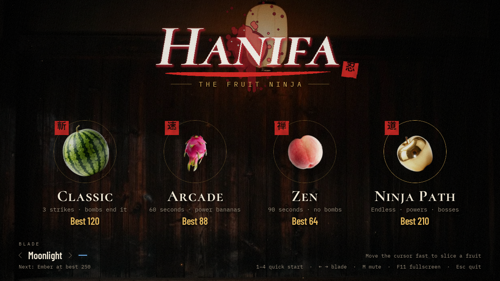
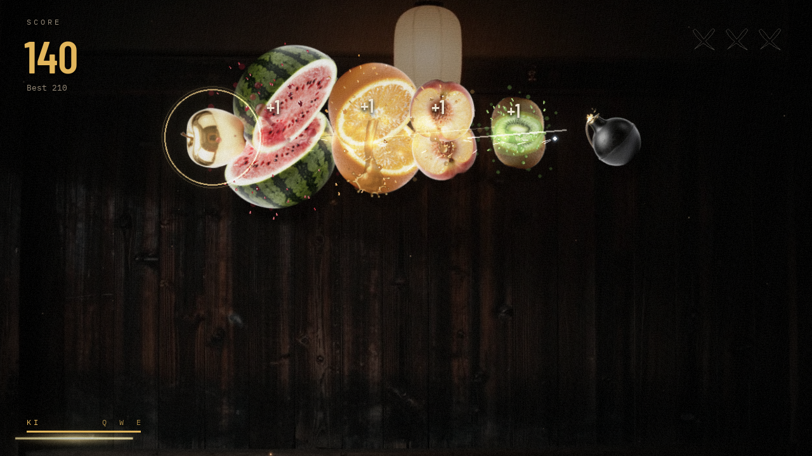

# Hanifa, the Fruit Ninja

A fruit-slicing game written in Python. You move the mouse fast across a fruit to cut it. The game is set on the
wooden wall of a dojo lit by a paper lantern, with photo-real fruit, juice splashes, red hanko seals for big
moments and GPU lighting effects. When the menu opens, a watermelon is tossed up and sliced, and the name
"Hanifa" is written in its juice.





This README is also a guide for learning how the game works. If you are new to the code, read it from top to
bottom: it explains the language, the libraries, where every file lives and what happens in one frame.

---

## Play it

- **In your browser:** <https://xikander7.github.io/fruit-ninja-game-v2/> (works best in Chrome, Edge or Firefox on a computer; click once to start)
- **On Windows:** download `FruitNinjaNightDojo-windows.zip` from the [v4.0 release](https://github.com/xikander7/fruit-ninja-game-v2/releases/tag/v4.0), unzip it and double-click
  `FruitNinjaNightDojo.exe`. You don't need to install Python.

## Quick start (from the source code)

You need Python 3.12 or newer.

```
pip install -r requirements.txt
python main.py
```

There is no clicking to slice. Moving the cursor fast (more than 300 pixels a second) is the blade.

| Where | Key / mouse | What it does |
|---|---|---|
| Menu | Slice a fruit, or press `1` `2` `3` `4` | Start Classic, Arcade, Zen or Ninja Path |
| Menu | `←` `→` (or `A` `D`, or the mouse wheel) | Pick a blade (better best scores unlock more) |
| Menu | Any key or a fast swipe | Skip the title intro |
| Playing | `Q` | Time Stop (when the Ki meter is full) |
| Playing | `W` | Shadow Clones |
| Playing | `E` | Dragon Fire |
| Playing | Right click | Use the last power again |
| Playing | `Esc` or `P` | Pause. While paused, `Q` goes back to the menu |
| Results | `Enter`, `R` or `Space` / `Esc` | Retry / back to the menu |
| Anywhere | `M` | Mute or unmute |
| Anywhere | `F11` | Fullscreen |

## Game modes and features

| Mode | Rules |
|---|---|
| Classic | Dropping a fruit is a strike; 3 strikes end the run. A bomb ends it at once. Every 100 points takes one strike back. |
| Arcade | 60 seconds. Bombs cost 10 points. Power bananas (Freeze, Frenzy, Double score). Ki powers and Fever. |
| Zen | 90 seconds, no bombs. Just slicing. |
| Ninja Path | Endless, with 3 lives. A dropped fruit or a bomb costs a life. A life comes back every 150 points. Ki powers, Fever, bosses and hazards. |

Slicing 3 or more fruit in one swipe is a combo and scores a bonus.

**Ki and the three powers** (Arcade and Ninja Path). Every cut fills the Ki meter (`KI_PER_CUT = 4` points; combos
add more). When it reaches 100 you can spend it:

- **Time Stop (`Q`)**: the world freezes for 3 seconds. Draw a path through the fruit, then every fruit you touched
  is cut in order.
- **Shadow Clones (`W`)**: three ghost blades fly out and cut fruit on their own for 5 seconds. They never hit bombs.
- **Dragon Fire (`E`)**: for 6 seconds, a fruit you cut bursts into flame and sets every fruit within 140 pixels on
  fire too.

**Fever** (Arcade and Ninja Path). Cuts in a row build a score multiplier: x2 after 10, up to x5. At x5 the dojo
goes gold for 8 seconds and fruit rains down. A strike or a bomb resets the chain.

**Bosses** (Ninja Path). After 45 seconds a Durian rises out of the dark, later a Pineapple King. Each takes 30 hits
before it splits open. If you are too slow it escapes.

**Hazards and special fruit** (Ninja Path, after 20 seconds):

- **Shuriken**: a throwing star flies at the screen. If it hits you, you lose a life. Slice it fast to knock it away.
- **Ice bomb**: slicing it freezes your blade for 2 seconds.
- **Golden fruit**: takes 5 hits, 5 points each, plus a bonus of 25 when it breaks.
- **Chaos fruit**: flips gravity upside down for 5 seconds, so fruit fall up.

---

## The language and technologies

### Python

The game is written in **Python**, a programming language that reads almost like English and doesn't need a
separate compile step. You run a file with `python main.py`.

- A **module** is one `.py` file. Other files can `import` what it defines.
- A **package** is a folder of modules. Here `ninja/` is a package, so `from ninja.game import App` works.
- A **class** is a blueprint for objects that keep their own data and functions (methods). For example, `Body` is
  one fruit flying through the air, and `Menu` is the menu screen.
- A **function** is a named piece of code you can call, such as `load_save()`.
- A **constant** is a value that is set once at the top of a file and written in CAPITALS, like `GRAVITY`.

*Why Python:* it is quick to write and easy to read, so it is a good language for learning how a game is built.

### pygame-ce

**pygame-ce** (the community edition of pygame) gives Python a window, a keyboard and mouse, sound and 2D drawing.

- The **window** is opened once with `pygame.display.set_mode`.
- A **surface** is an image in memory you can draw on. The screen is a surface, and so is every sprite.
- **Events** are things that happened since the last frame, such as the mouse moving or a key being pressed.
  `pygame.event.get()` hands you the list.
- The **game loop** runs about 120 times a second: read events, update the world, draw it and show it.

*Why pygame-ce:* it is the most widely used way to make 2D games in Python, it is free, and it runs on Windows,
macOS, Linux and (through pygbag) in the browser.

### moderngl, OpenGL and GLSL shaders

Your graphics card (GPU) can run small programs called **shaders** on every pixel at the same time. They are written
in **GLSL**, a C-like language, and **moderngl** lets Python send them to the GPU through **OpenGL**.

The game draws everything on the CPU first and then hands the finished picture to a shader in `ninja/gpu.py`
that adds:

- **bloom**: bright things (the blade, sparks, fire) glow and bleed light into their surroundings;
- **vignette**: the corners get slightly darker, so your eye goes to the middle;
- **chromatic aberration**: red, green and blue shift apart a little, like a cheap lens, when a bomb goes off;
- shockwaves, zoom punches on combos, colour grades for slow motion, film grain.

*Why:* these effects would be far too slow pixel by pixel in Python, but they are almost free on a GPU. If there is
no GPU (or in the browser), the game falls back to a CPU renderer that looks nearly the same. You can force the
fallback with the environment variable `NINJA_NO_GPU=1`.

### unittest

**unittest** is Python's built-in testing library. A test is a small function that sets something up and checks
the result with `assertEqual`, `assertTrue` and so on. *Why:* tests catch it straight away when a change breaks a
rule of the game. See [Tests](#tests).

### Dev tools: numpy, PyInstaller, pygbag

These are only needed for building things, not for playing. They are listed in `requirements-dev.txt`.

- **numpy** does fast maths on big arrays of numbers. `tools/build_audio.py` and `tools/build_web.py` use it to
  process sound files.
- **PyInstaller** packs Python, pygame and the game into a folder with a `.exe`, so Windows users don't need Python.
- **pygbag** packs the game for the web. It runs real Python compiled to **WebAssembly** inside the browser.

### OFL fonts

The fonts are **Cormorant SC** (titles), **Barlow Condensed** (numbers) and **IBM Plex Mono** (small labels). They
are under the **SIL Open Font License (OFL)**, which allows you to bundle them with a game. The licence files are in
`assets/fonts/`. The kanji on the seals come from your system's Japanese font, or from stencils made from **Zen
Kaku Gothic New** (also OFL) in `assets/glyphs/` when there isn't one.

---

## Folder and file map

```
fruit-ninja-game-v2/
├── main.py                 Starts the game: desktop loop, browser (async) loop, NINJA_SMOKE test mode
├── requirements.txt        What the game needs: pygame-ce, moderngl
├── requirements-dev.txt    Extra tools for building: numpy, pyinstaller, pygbag
├── ninja/                  The game itself (a Python package)
│   ├── settings.py         Screen size, GRAVITY, colours, BLADES, MODES, TITLE, resource_path(), save location
│   ├── game.py             The App (window + loop) and the scenes: World, Menu, Play, GameOver, Wipe; saving
│   ├── title.py            The menu's title intro: the tossed watermelon and the "Hanifa" signature
│   ├── entities.py         Body (a whole fruit or bomb) and Half (a cut half): movement and drawing
│   ├── art.py              Loads sprites and fonts, draws fallback art, makes hanko seals
│   ├── audio.py            Loads sounds (or synthesizes them if missing) and plays them
│   ├── fx.py               Juice particles, stains, the blade trail, screen shake, score popups, seal stamps
│   ├── gpu.py              PostFX: the GLSL shaders for bloom, vignette, aberration, shockwaves, grain
│   ├── hud.py              The heads-up display: score, timer, strikes/lives, Ki meter, multiplier, boss bar
│   ├── powers.py           The Ki meter and the three powers: TimeStop, ShadowClones, DragonFire
│   ├── fever.py            The cut chain, the score multiplier and the fruit rain
│   ├── boss.py             Boss (Durian, Pineapple King) and BossDirector (when one appears)
│   └── hazards.py          Shuriken, ice bomb, golden fruit, chaos fruit
├── tests/                  Automatic checks (see Tests below)
├── tools/
│   ├── build_sprites.py    Turns raw source images (assets/raw, not in git) into game sprites
│   ├── build_audio.py      Turns raw source audio into game-ready WAV files
│   ├── build_glyphs.py     Renders the kanji stencils in assets/glyphs from an OFL font
│   ├── build_windows.py    Builds the Windows edition with PyInstaller
│   └── build_web.py        Builds the browser edition with pygbag
├── assets/
│   ├── sprites/            Fruit, halves, bomb, bosses, hazards, juice splashes, background.jpg
│   ├── audio/              Sound effects and music (WAV)
│   ├── fonts/              The three OFL fonts and their licences
│   └── glyphs/             Kanji stencils for the seals (used when there is no Japanese system font)
├── docs/
│   ├── screenshot.png      The menu (shown at the top of this file)
│   ├── gameplay.png        A four-fruit combo
│   ├── plans/              Older implementation plans
├── index.html, script.js, style.css   The original browser game (HTML + JavaScript) from the main branch
└── .gitignore              Keeps build output (build/, dist/) and raw assets out of git
```

---

## How one frame works

About 120 times a second, `App.frame_step()` in `ninja/game.py` runs one frame:

1. **Input.** `App.step` reads the events. Every mouse movement adds a point to the blade's path. If the cursor
   moved faster than `SLICE_SPEED` (300 px/s), the path between those points becomes **slicing segments**: short
   lines that cut anything they cross.
2. **Update.** The current scene's `update(dt)` runs (`dt` is the time since the last frame, in seconds). In
   `Play.update`, the **world** moves every fruit (gravity pulls them down), then the hooks run:
   **powers** (`tick_power`), **fever** (`tick_fever`), the **boss** (`tick_boss`) and **hazards**
   (`tick_hazards`). `Play.slice` checks every segment against every fruit (`seg_hits_circle`) and cuts what it hits.
3. **Draw.** The scene draws into three layers:
   - `app.frame`: the world (wall, fruit, halves, juice, stains);
   - `app.add`: things that **glow** (blade, sparks, fire), added on top as light;
   - `app.ui`: text and the HUD, which must stay sharp and never be bent by effects.
4. **Post-processing.** With a GPU, `PostFX.render` in `ninja/gpu.py` combines `frame` and `add`, applies bloom,
   vignette, aberration and so on, and then lays `ui` over the top. Without a GPU, the layers are just blended
   together on the CPU.
5. **Screen.** `pygame.display.flip()` shows the finished picture.

```
 mouse / keys
      |
      v
 App.step ---- fast movement? ----> slicing segments
      |                                   |
      v                                   v
 scene.update(dt)   Play: world moves, powers, fever, boss, hazards, slice
      |
      v
 scene.draw
   +-- app.frame  (world: wall, fruit, juice)
   +-- app.add    (glow: blade, sparks, fire)
   +-- app.ui     (HUD, text)
      |
      v
 GPU: PostFX.render  (bloom, vignette, aberration, then UI on top)
   or CPU: blend the layers
      |
      v
 pygame.display.flip()  ->  screen
```

---

## How saving works

Your scores are saved in a small JSON text file in your home folder: `~/.fruit_ninja_dojo.json` (on Windows
that's `C:\Users\<you>\.fruit_ninja_dojo.json`). `load_save()` and `write_save()` in `ninja/game.py` read and
write it. It looks like this:

```json
{
  "best": {"classic": 120, "arcade": 88, "zen": 64, "path": 210},
  "blade": "Moonlight",
  "muted": false,
  "total_sliced": 431
}
```

- `best`: your best score in each mode (these unlock blades);
- `blade`: the blade you picked;
- `muted`: whether sound is off;
- `total_sliced`: every fruit you have ever cut.

The file is written to a temporary file first and then swapped in, so a crash never leaves half a save. A missing
or broken file just starts you fresh. In the browser edition the save is also kept in the browser's local storage.

---

## Tests

```
python -m unittest discover -s tests -v
```

The tests run without opening a window (they use SDL's "dummy" video driver and the CPU renderer), so they work
anywhere. The GPU tests make a hidden OpenGL context and skip themselves if there isn't one.

| File | What it checks |
|---|---|
| `tests/test_game.py` | The slicing maths, slow drift doesn't cut, a full scripted run through every screen, corrupt saves |
| `tests/test_modes.py` | Which systems each mode runs, Ninja Path lives and bombs, Fever in each mode, old saves still load |
| `tests/test_powers.py` | Ki filling and spending, each power's rules, powers refused while paused or not full |
| `tests/test_fever.py` | Multiplier steps, Fever starting at x5, resets, fruit rain |
| `tests/test_boss.py` | Boss hits, cooldown, escape, timing, game over with a boss on screen |
| `tests/test_hazards.py` | Shuriken hits and parries, ice bomb freeze, golden fruit hits, chaos gravity |
| `tests/test_fx.py` | Blade smoothing, effects fading back to normal, slow motion |
| `tests/test_gpu.py` | The shaders: bloom, zoom, shockwaves, the UI layer staying untouched |
| `tests/test_art.py` | Sprites load with transparency, fallbacks when files are missing, juice splashes |
| `tests/test_audio.py` | Every sound is found, and synthesized fallbacks when files are missing |
| `tests/test_ui.py` | Every screen draws, the title intro settles and can be skipped, fonts fall back |
| `tests/test_package.py` | The Windows and browser editions find their files, the frame step, kanji stencils |

---

## Try changing this

Small, safe experiments. Change one value, run `python main.py` and see what happens. Undo with `git checkout -- .`

1. **Moon gravity.** In `ninja/settings.py`, set `GRAVITY = 1250.0` to `600.0`. Fruit float up higher and fall slowly.
2. **Faster Ki.** In `ninja/powers.py`, raise `KI_PER_CUT = 4` to `20`. You can use a power after about five cuts.
3. **A tougher boss.** In `ninja/boss.py`, change `HP = 30` to `60`. (Keep it above the crack points in `CRACK_AT`.)
4. **Your own blade colours.** In `ninja/settings.py`, find `BLADES` and change the three colours of `"Moonlight"`
   (outer glow, middle, core), for example to `(0, 120, 40), (80, 255, 120), (230, 255, 230)` for a green blade.
5. **A longer Fever.** In `ninja/fever.py`, change `FEVER_TIME = 8.0` to `15.0`.
6. **A harder slice.** In `ninja/game.py`, raise `SLICE_SPEED = 300` to `900`. Now only quick flicks cut.

Then run the tests to see which rules you changed: some tests check these exact values on purpose.

---

## Building the shareable editions

First install the build tools: `pip install -r requirements-dev.txt`.

**Windows (.exe):**

```
python tools/build_windows.py
```

This makes `dist/FruitNinjaNightDojo/` (with `FruitNinjaNightDojo.exe`) and `dist/FruitNinjaNightDojo-windows.zip`
to share. The game finds its pictures and sounds inside the bundle through `resource_path()` in
`ninja/settings.py`. To check a build, run it with `NINJA_SMOKE=1`: it plays 180 frames and reports how many sprites,
fonts and sounds it loaded.

**Browser:**

```
python tools/build_web.py
python -m http.server 8000 -d build/web_src/build/web
```

The first command copies the game into `build/web_src/` (with smaller, mono sound files), then pygbag builds a
static website in `build/web_src/build/web/`: an `index.html` and the game archive. The second command serves it
at `http://127.0.0.1:8000` so you can try it. Any static host can serve that folder, for example GitHub Pages. In
the browser there is no OpenGL, so the CPU renderer is used.

---

## Branch history

The repository has grown in four steps, each on its own branch:

| Branch | Version | What it is |
|---|---|---|
| `main` | v1 | The original web game in HTML, CSS and JavaScript (`index.html`, `script.js`, `style.css`) |
| `feature/pygame-ninja` | v2 | Rewritten in Python with pygame-ce: the dojo, three modes, blades, seals |
| `feature/premium-ninja` | v3 | Photo-real art and sound, GPU post-processing, juice splashes |
| `feature/ninja-path` | v4 | Ninja Path mode: Ki powers, Fever, bosses, hazards; the "Hanifa" title; Windows and browser editions |

To look at an older version: `git checkout feature/premium-ninja` (and `git checkout feature/ninja-path` to come back).
