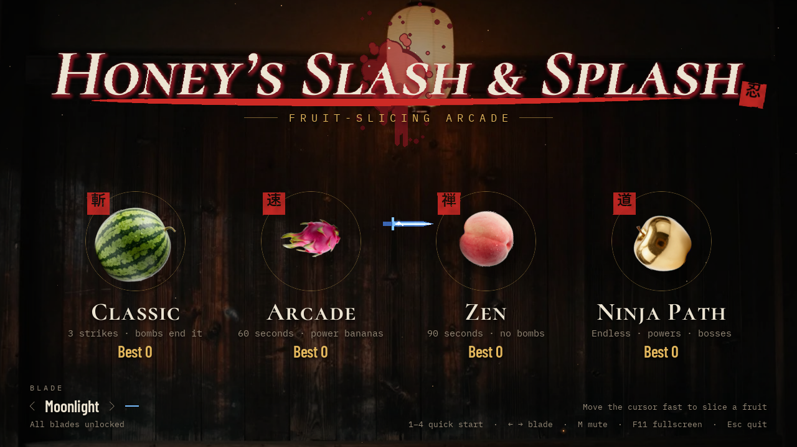
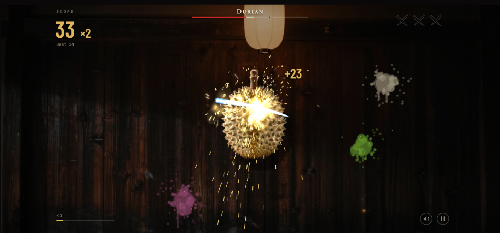

# Hanifa, the Fruit Ninja

A fruit-slicing game. You swipe across fruit to cut it. It is set on the wooden wall of a dojo lit by a paper
lantern, with photographic fruit, juice splashes, red hanko seals for the big moments and glowing light effects. When
the menu opens, a watermelon is tossed up and sliced, and the name "Hanifa" is written in its juice.





The game exists in two versions that share the same pictures, sounds and rules:

- a **web version** in JavaScript (folder `web/`), which runs in any browser on a computer, an Android phone or an
  iPhone;
- a **desktop version** in Python (folder `ninja/`), which also builds into a Windows `.exe`.

This file is written for someone new to programming. It explains how to play, what each technology is for, what every
file does and how one frame of the game is made.

## Contents

1. [Play it](#play-it)
2. [Controls and game modes](#controls-and-game-modes)
3. [How the project fits together](#how-the-project-fits-together)
4. [The languages used in this project](#the-languages-used-in-this-project)
5. [Why Python, and which languages could build this](#why-python-and-which-languages-could-build-this)
6. [The technologies, in plain words](#the-technologies-in-plain-words)
7. [Every file and folder](#every-file-and-folder)
8. [How one frame works](#how-one-frame-works)
9. [The web version in detail](#the-web-version-in-detail)
10. [How saving works](#how-saving-works)
11. [Tests](#tests)
12. [Try changing something](#try-changing-something)
13. [Build, run and publish](#build-run-and-publish)
14. [History of the project](#history-of-the-project)

---

## Play it

- In a browser: <https://xikander7.github.io/fruit-ninja-game-v2/>. It works on computers and phones. On a phone, tap
  "Tap to play". You can hold the phone sideways or upright, and the game fills the screen either way.
- On Windows: download `FruitNinjaNightDojo-windows.zip` from the
  [v4.0 release](https://github.com/xikander7/fruit-ninja-game-v2/releases/tag/v4.0), unzip it and double-click
  `FruitNinjaNightDojo.exe`. You do not need Python.
- From the source code (desktop version): you need Python 3.12 or newer.

  ```
  pip install -r requirements.txt
  python main.py
  ```

- From the source code (web version): see [Build, run and publish](#build-run-and-publish).

## Controls and game modes

There is no clicking to slice. Moving the pointer fast (more than 300 pixels a second) is the blade. A slow drift
does not cut. On a touch screen, drag your finger across the fruit.

| Where | Keyboard or mouse | Touch | What it does |
|---|---|---|---|
| Menu | Slice a fruit, or press 1, 2, 3, 4 | Swipe or tap a fruit | Start Classic, Arcade, Zen or Ninja Path |
| Menu | Left and right arrows (or A, D, or the mouse wheel) | Tap the arrows | Pick a blade. Better best scores unlock more blades |
| Playing | Q, W, E | Tap a seal beside the Ki bar | Time Stop, Shadow Clones, Dragon Fire (when the Ki bar is full) |
| Playing | Right click | | Use the last power again |
| Playing | Esc or P | Pause button | Pause. While paused, Q goes back to the menu |
| Results | Enter, R or Space / Esc | Slice or tap the fruit | Retry / back to the menu |
| Anywhere | M | Speaker button | Mute or unmute |
| Anywhere | F (web), F11 (desktop) | Fullscreen button | Fullscreen |

| Mode | Rules |
|---|---|
| Classic | Dropping a fruit is a strike. Three strikes end the run. A bomb ends it at once. Every 100 points takes one strike back. |
| Arcade | 60 seconds. Bombs cost 10 points. Power bananas give Freeze, Frenzy or Double score. Ki powers and Fever are on. |
| Zen | 90 seconds, no bombs. Just slicing. |
| Ninja Path | Endless, with 3 lives. A dropped fruit or a bomb costs a life, and a life comes back every 150 points. Ki powers, Fever, bosses and hazards are on. |

Slicing three or more fruit in one swipe is a combo and scores a bonus.

Ki and the three powers (Arcade and Ninja Path). Every cut fills the Ki meter by 4 points, and combos add more. At
100 you can spend it:

- Time Stop: the world freezes for 3 seconds. Draw a path through the fruit, then every fruit you touched is cut in
  order.
- Shadow Clones: three ghost blades hunt fruit on their own for 5 seconds. They never hit bombs.
- Dragon Fire: for 6 seconds a fruit you cut bursts into flame and sets every fruit within 140 pixels on fire too.

Fever (Arcade and Ninja Path). Cuts in a row build a score multiplier: x2 after 10 cuts, up to x5. At x5 the dojo
turns gold for 8 seconds and fruit rains down. A strike or a bomb resets the chain.

Bosses (Ninja Path). After 45 seconds a Durian rises out of the dark. Later comes a Pineapple King. Each takes 30
hits before it splits open, and if you are too slow it escapes.

Hazards and special fruit (Ninja Path, after 20 seconds):

- Shuriken: a throwing star flies at your pointer. If it hits, you lose a life. Slice it fast to knock it away.
- Ice bomb: slicing it freezes your blade for 2 seconds.
- Golden fruit: it takes 5 hits, worth 5 points each, plus 25 when it breaks.
- Chaos fruit: gravity flips upside down for 5 seconds, so fruit fall upward.

---

## How the project fits together

```
                 assets/  (sprites, sounds, fonts, kanji stencils)
                    |
        +-----------+-----------+
        |                       |
   ninja/ (Python)        tools/build_web_js.py
   desktop game           converts sounds, copies art
        |                       |
   main.py                 web/assets/  (not stored in git)
   PyInstaller                  |
        |                  web/ (JavaScript)
   Windows .exe            browser game
                                |
                       tools/deploy_web.py
                                |
                       GitHub Pages (gh-pages branch)
```

Both versions follow the same rules and use the same numbers (gravity 1250, slice speed 300 px/s, 30 boss hits and
so on). The Python code in `ninja/` is the reference. The JavaScript code in `web/src/` is a port of it. The numbers
live in two places, so if you change a rule in one version, change it in the other too.

Why two versions? Browsers run JavaScript natively and draw with the graphics card. Python can only run in a browser
if the whole Python interpreter is shipped to the page, and in that form the game was too slow on phones, could not
fill the window and had crackling sound. So the web version is plain JavaScript, and the Python version stays as a
desktop game.

---

## The languages used in this project

The game is built from several languages, each doing the job it suits best. Most of the code is Python and
JavaScript.

| Language | Lines (about) | Where | What it does |
|---|---|---|---|
| Python | 5,300 | `ninja/`, `main.py` | The desktop game: rules, drawing, sound, menus, bosses, powers |
| Python | 1,700 | `tests/` | Automatic checks of the desktop game |
| Python | 550 | `tools/` | Build scripts: prepare sprites and sounds, build the Windows `.exe`, publish the website |
| JavaScript | 5,200 | `web/src/` | The web game: the same rules, drawing, sound and touch controls, running in the browser |
| JavaScript | 175 | `web/tests/` | Checks of the web game's rules |
| HTML and CSS | 50 | `web/index.html` | The loading screen, the Play buttons and the canvas the game draws on |
| GLSL | inside `ninja/gpu.py` | desktop only | Small programs that run on the graphics card for glow, shockwaves and the vignette |
| JSON | tiny | the save file, `audio/manifest.json` | Plain data: your scores and the list of sound files |

The art and sounds are not code. They are PNG and JPG images, WAV audio and TTF font files that both versions load.

There are two games here, and they share one set of pictures, sounds and rules:

- The desktop game is Python. It uses pygame-ce for the window, drawing and sound, and moderngl to run the
  graphics-card effects. PyInstaller packs it into a Windows program.
- The web game is JavaScript. It draws on an HTML canvas, plays sound through the browser's Web Audio, and runs from a
  website link. It needs no libraries and no install step.

Python also does the preparation work: it converts the sounds, copies the art, builds the Windows version and
publishes the website.

If you want to read the code, start with the short files that have no drawing in them: `web/src/rules/` for
JavaScript, or `ninja/fever.py` for Python. The file map below explains the rest.

---

## Why Python, and which languages could build this

The desktop game is written in Python because Python is the most common language to learn first. It is easy to read,
it has a huge community, and a beginner can follow the code without much setup. That is the reason it was chosen,
and it is a good reason for learning. It is not the best choice for every goal, so here is the full picture.

What matters most is where the game has to run. A language that is native to the place you ship to will always have
the smoothest result.

### Languages ranked for a game like this, shipped live on the web and on phones

| Rank | Language and tools | Where it runs | Good at | Weak at | Best for |
|---|---|---|---|---|---|
| 1 | JavaScript or TypeScript (Canvas 2D, or the libraries PixiJS and Phaser) | Every browser on every phone and computer, with nothing to install | Starting from a link. Small downloads. Touch, sound and fullscreen are built into the browser. TypeScript adds type checking that catches mistakes early | Very heavy 3D or huge simulations. Not an app-store app unless wrapped | A game that must be live today. This is what the web version here uses |
| 2 | Godot (GDScript, or C#) | Web, Android, iPhone, Windows, Mac, Linux from one project | A complete engine: scenes, physics, animation, an editor. Free and open source. Good 2D | The web export is a bigger download than a hand-written web game, and phones load it slower | A game you want on app stores as well as the web |
| 3 | Unity (C#) | Almost everything, including consoles | Huge tooling, the biggest job market, many ready-made assets | Heavy for a small 2D game. Web builds are large and slow to start | A bigger team, 3D, or console releases |
| 4 | Rust compiled to WebAssembly (Bevy, macroquad) | Browsers and desktop | Very fast and memory safe. Small output files | Slower to write. A steep learning curve for beginners | A game with heavy calculations, or a developer who wants Rust |
| 5 | Dart with Flutter (the Flame engine) | Android, iPhone, web, desktop | One code base for phone apps. Smooth user interface | The web build is heavy, and the game tooling is smaller than the others | Mobile apps that are mostly interface with some game parts |
| 6 | Python (pygame) | Windows, Mac and Linux. In a browser only through a slow workaround | Easiest to learn and read. Great for prototypes, tools and teaching. Strong libraries for data and file processing | Needs the whole Python interpreter to run in a browser, so it is slow and large on phones. Weak on mobile stores | Learning, desktop games, and build scripts |

Other languages that are worth knowing about:

- C# with MonoGame is a solid choice for desktop games.
- C++ with Unreal Engine or SDL powers most big commercial games. It gives the best speed and the hardest learning
  curve.
- Lua with LÖVE is tiny and quick for 2D prototypes, and it has no good mobile or browser story.
- Swift (iPhone and Mac) and Kotlin (Android) are the native languages for each phone system, and each runs only
  there.
- Java with libGDX still works for Android and desktop games.

### How to choose

Ask three questions in this order:

1. Where must it run? If the answer is "in a browser, from a link, on any phone", pick JavaScript or TypeScript. If
   it is "on app stores", pick Godot or Unity. If it is "on my own computer", almost anything works, including
   Python.
2. Who is building it? A beginner gets the most from a language they can read, which is why Python and JavaScript
   come first for learning.
3. How heavy is the game? A 2D slicer like this one is light. Only 3D worlds and big simulations need the bigger
   engines or a systems language.

### What happened in this project

This game started as plain JavaScript (version 1), was rebuilt in Python with pygame (version 2 onward) for the
desktop look and the Windows build, and was then packed for browsers with a tool that runs Python inside the page.
That last step was the weak point: it was slow on phones, could not fill the window and made crackling sound. So the
web version was ported back to JavaScript, and the Python version stayed as the desktop game. The two share the
same assets and rules. The lesson for a beginner: use the language you know to learn and to prototype, and use the
language the target platform speaks when you ship.

---

## The technologies, in plain words

### Python (desktop version)

Python is a programming language that reads close to English and runs without a separate compile step.

- A module is one `.py` file. Other files can `import` things from it.
- A package is a folder of modules. `ninja/` is a package, so `from ninja.game import App` works.
- A class is a blueprint for objects that hold their own data and functions. `Body` is one fruit flying through the
  air, and `Menu` is the menu screen.
- A constant is a value set once at the top of a file and written in capitals, like `GRAVITY`.

### pygame-ce

pygame-ce gives Python a window, keyboard and mouse, sound and 2D drawing. A surface is an image in memory you can
draw on. The screen is a surface and so is every sprite. Events are things that happened since the last frame, such
as a mouse movement. The game loop runs about 120 times a second: read events, update the world, draw it, show it.

### moderngl, OpenGL and GLSL

A graphics card can run small programs, called shaders, on every pixel at once. They are written in GLSL, and
moderngl sends them to the card through OpenGL. The desktop version draws on the CPU first, then a shader in
`ninja/gpu.py` adds bloom (bright things glow), a darker vignette, colour fringing when a bomb goes off, shockwaves,
zoom punches and film grain. Without a suitable graphics card the game falls back to a CPU version of the look. You
can force that with the environment variable `NINJA_NO_GPU=1`.

### JavaScript, HTML and ES modules (web version)

JavaScript is the language browsers run. HTML describes the page, and `web/index.html` is a loading screen, a canvas
and a script tag. The code is split into ES modules: each file starts with `import` lines naming what it needs and
exports what others may use. There is no build step and no npm install. The browser loads the files as they are.

### Canvas 2D

A `<canvas>` is a rectangle of pixels you draw on from JavaScript, much like a pygame surface. The web version draws
into several canvases (the world, the glow, the interface) and lays them on top of each other. Adding light is done
with the "lighter" blend mode, which is the same as pygame's additive blit.

### Web Audio

The Web Audio API mixes sound on its own thread, separate from the game. A slow frame cannot starve it, which is what
caused the crackle in the old browser build. All sound goes through one limiter so a pile of splats, a bomb and the
Fever drums never add up past full volume.

### Node test runner, unittest, pytest

A test is a small function that sets something up and checks the result. The Python tests use `unittest` (run with
pytest). The JavaScript rules tests use the test runner built into Node.js (`node --test`).

### PyInstaller

PyInstaller packs Python, pygame and the game into a folder with a `.exe`, so Windows users do not need Python.

### GitHub Pages

GitHub Pages serves a folder of static files from the `gh-pages` branch. The web game needs nothing else, because all
the work happens in the player's browser.

### numpy

numpy does fast maths on large arrays. The build tools use it to process sound files.

### Fonts

Cormorant SC (titles), Barlow Condensed (numbers) and IBM Plex Mono (small labels) are under the SIL Open Font
License, which allows bundling them with a game. The licences are in `assets/fonts/`. The kanji on the seals are
stencils in `assets/glyphs/`, made from Zen Kaku Gothic New (also OFL).

---

## Every file and folder

```
fruit-ninja-game-v2/
├── README.md               This file
├── main.py                 Starts the desktop game (and the NINJA_SMOKE=1 self-check)
├── requirements.txt        What the desktop game needs: pygame-ce, moderngl
├── requirements-dev.txt    Build tools: numpy, pyinstaller
├── .gitignore, .gitattributes
├── assets/                 Shared by both versions
├── ninja/                  The desktop game (Python package)
├── tests/                  Python tests
├── tools/                  Scripts that build assets and releases
├── web/                    The web game (JavaScript)
└── docs/                   Screenshots used by this file
```

### assets/

| Folder | What is in it |
|---|---|
| `sprites/` | One PNG per fruit, one per cut half (`apple_half.png`), the bomb, ice bomb, shuriken, the Durian and Pineapple King, four juice splash photos, and `background.jpg` (the dojo wall) |
| `audio/` | Sound effects and music as WAV files. Names look like `splat1_3.wav`: the letters say which sound, the last number is the variation |
| `fonts/` | The three fonts and their licence files |
| `glyphs/` | One PNG per kanji character used on the seals, named by the character's hex code (`65ac.png` is the character 斬) |

`assets/raw/` holds the unprocessed source files. It is not stored in git.

### ninja/ (desktop game)

| File | What it does |
|---|---|
| `settings.py` | Screen size, gravity, colours, the blades and modes tables, where the save file lives, `resource_path()` for finding files inside the `.exe` |
| `game.py` | `App` (window and main loop) and the screens: `World`, `Menu`, `Play`, `GameOver`, `Wipe` (the cut-in-two transition). Also loading and writing the save |
| `title.py` | The title intro: the tossed watermelon and the "Hanifa" signature |
| `entities.py` | `Body` (a whole fruit or bomb) and `Half` (a cut half): movement and drawing |
| `art.py` | Loads sprites and fonts, draws fallback art if a file is missing, makes the hanko seals |
| `audio.py` | Loads sounds (or makes simple ones in code if a file is missing) and plays them |
| `fx.py` | Juice particles, stains on the wall, the blade trail, screen shake, score popups, seal stamps |
| `gpu.py` | The GLSL shaders for bloom, vignette, colour fringing, shockwaves and grain |
| `hud.py` | Score, timer, strikes and lives, Ki meter, multiplier, boss bar |
| `powers.py` | The Ki meter and the three powers |
| `fever.py` | The cut chain, the multiplier and the fruit rain |
| `boss.py` | `Boss` (Durian, Pineapple King) and `BossDirector` (decides when one appears) |
| `hazards.py` | Shuriken, ice bomb, golden fruit, chaos fruit |

### tests/ (Python)

One test file per area: `test_game.py` (slicing maths, a scripted run through every screen), `test_modes.py`,
`test_powers.py`, `test_fever.py`, `test_boss.py`, `test_hazards.py`, `test_fx.py`, `test_gpu.py` (skips itself
without OpenGL), `test_art.py`, `test_audio.py`, `test_ui.py`, `test_package.py`.

### tools/

| File | What it does |
|---|---|
| `build_sprites.py` | Turns the raw cutouts in `assets/raw` into the game sprites |
| `build_audio.py` | Splits and trims the raw audio into game-ready WAV files |
| `build_glyphs.py` | Renders the kanji stencils from an OFL font |
| `build_windows.py` | Builds the Windows edition with PyInstaller |
| `build_web_js.py` | Builds `web/assets/`: converts the sounds to 22 kHz mono, copies sprites, fonts and glyphs, writes the sound list |
| `deploy_web.py` | Builds the site into `build/site` and, with `--push`, publishes it to the `gh-pages` branch |

### web/ (web game)

The page and the tests:

| File | What it does |
|---|---|
| `index.html` | The page: loading screen with a progress bar, the Play buttons, the game canvas, and the CSS that centres and scales it |
| `package.json` | Only says "treat .js files as ES modules" so Node can run the tests |
| `favicon.png` | The tab icon |
| `tests/rules.test.mjs` | The rules tests |
| `assets/` | Built by `tools/build_web_js.py`. Not stored in git |

The rules, in `web/src/rules/`. These files have no drawing code, so Node can test them:

| File | What it does |
|---|---|
| `collide.js` | Does a swipe segment touch a circle, rotating a point, how big a thrown fruit looks at the top of its arc |
| `fever.js` | The chain, the x1 to x5 multiplier, the 8 second Fever and its fruit rain |
| `ki.js` | The Ki meter |
| `boss.js` | The boss: 30 hit points, rise, hover and escape phases, crack stages, and when the next boss appears |
| `hazards.js` | The hazard odds, the shuriken's flight and how a parry bounces it, and constants for ice and golden fruit |
| `save.js` | Reading and writing the save, with fallbacks for missing or broken data |

The game, in `web/src/`:

| File | What it does |
|---|---|
| `main.js` | Loads everything with a progress bar, waits for the first tap (browsers keep sound locked until then), starts the frame loop |
| `net.js` | Loads files six at a time and retries a failed one, so a weak phone connection does not stop the game |
| `config.js` | Sizes, colours, the fruit table, modes, blades. The `VIEW` object records the visible area |
| `util.js` | Random-number helpers, colour helpers, a seeded random generator |
| `gfx.js` | Drawing helpers: rotated sprites, cached glow images, shadows, blur, curve smoothing |
| `assets.js` | Loads sprites, fonts and glyphs. Builds shadows, juice-tinted splashes, the hanko seals, the wall with its vignette, the text cache |
| `ui.js` | Small helpers for placing text and drawing labels and bars |
| `input.js` | Turns mouse, touch and keyboard events into a simple list of events with stage coordinates |
| `audio.js` | The Web Audio mixer: loading, one music voice, sound effects, the limiter |
| `app.js` | The window, the layers, input to slicing, the frame loop, scene changes, fullscreen |
| `world.js` | The world: fruit, halves, particles, stains, shake, slow motion, the cut and bomb effects |
| `entities.js` | `Body` and `Half`: a thrown fruit and a cut half |
| `fx.js` | Particles, juice stains, blade trail, screen shake, score popups, seal stamps |
| `menu.js` | The menu, plus `SliceButton`, the fruit you cut to choose |
| `play.js` | A run: spawning waves, scoring, combos, strikes, the clock, pause |
| `gameover.js` | The results screen |
| `hud.js` | Score, timer, strikes, Ki bar and power seals, the colour grades over the world, the on-screen buttons |
| `powers.js` | Time Stop, Shadow Clones, Dragon Fire |
| `fever.js` | How Fever plugs into a run |
| `boss.js` | How a boss looks (sprite, cracks, split halves) and how it plugs into a run |
| `hazards.js` | How hazards plug into a run and how they are drawn |
| `title.js` | The title intro |
| `wipe.js` | The transition that cuts the screen in two |

---

## How one frame works

### Desktop version

About 120 times a second `App.frame_step()` in `ninja/game.py` runs one frame:

1. Input. `App.step` reads the events. Each mouse movement adds a point to the blade's path. If the pointer moved
   faster than 300 px/s, the path becomes slicing segments: short lines that cut anything they cross.
2. Update. The current screen's `update(dt)` runs, where `dt` is the time since the last frame in seconds. In a run,
   the world moves every fruit (gravity pulls them down), then powers, fever, the boss and hazards each get a turn,
   and `Play.slice` checks every segment against every fruit.
3. Draw. The screen draws into three layers: the world, the glow (light that gets added on top) and the interface
   (text that must stay sharp).
4. Post-processing. With a graphics card, `PostFX.render` blends the layers, applies bloom and the other effects, and
   lays the interface on top. Without one, the layers are blended on the CPU.
5. Show. `pygame.display.flip()` puts the picture on screen.

### Web version

`requestAnimationFrame` in `web/src/main.js` calls `app.frameStep()` once per screen refresh (60 times a second on
most screens). The steps match the desktop version:

1. `input.js` has been collecting events all the time. `App.step` turns the pointer movements into slicing segments
   with the same 300 px/s rule.
2. The current scene's `update(dt)` runs. `dt` is capped at 1/20 s so a stalled tab cannot make fruit jump.
3. The scene's `draw()` fills three canvases: `L` (the world), `add` (glow, black means no glow) and `ui`.
4. `App.compose()` stacks them on the visible canvas. The world and glow get the camera: zoom for combo punches,
   shake for bombs. The glow is also blurred by shrinking it in steps and adding it back, which gives the bloom. The
   colour drain (slow motion, Time Stop) is a grey layer in the "saturation" blend mode. Then come the scene's colour
   grades (frost, embers, Fever gold), the flash, the interface canvas, the scene-change wipe and the blade.

```
 pointer / touch / keys
        |
   input.js  -> events
        |
   App.step  -> slicing segments (speed > 300 px/s)
        |
   scene.update(dt)     run: waves, fruit move, powers, fever, boss, hazards, cuts
        |
   scene.draw()  ->  L (world)   add (glow)   ui (text, HUD)
        |
   App.compose():  camera + bloom + colour drain + grades + flash + ui + wipe + blade
        |
   visible <canvas>
```

---

## The web version in detail

### The stage and the view

All game rules work on a fixed stage of 1280 by 720 units. The window is almost never exactly that shape, so
`App.resize()` works out a view: the stage plus extra wall around it. A wide window shows more wall left and right, a
tall one shows more above and below, within limits. The dojo wall image is stretched to cover the whole view, so
there are no black bars on a laptop or a phone. `VIEW` in `config.js` stores the size and the offset of the stage
inside the view, and every layer is drawn with that offset applied. Things that must start off screen (a shuriken,
Frenzy fruit) use the view's edges, so they do not pop in mid-screen on a wide display.

### Phones

- Touch: a finger is the blade. A new touch never cuts a line from where the last one ended. Only the first finger
  counts.
- Fullscreen and landscape: tapping Play on a touch device asks the browser for fullscreen and tries to lock the
  screen to landscape. Some browsers refuse (iPhone Safari has no fullscreen for pages), and the page still fills the
  screen.
- Upright phones: if the phone is held upright and rotation is locked, `App.resize()` draws the game turned a quarter
  turn so it still fills the screen, and `input.js` turns touch positions back.
- Buttons: pause, mute and fullscreen are drawn on screen. Seals for the three powers appear next to the Ki bar when
  it is full.
- Slow phones: `App.adapt()` watches the frame time. If frames stay slow, it turns the glow down a step, then off,
  and lowers the particle limit.

### Sound

`audio.js` builds this chain: every sound effect goes to the effects bus, the music goes to the music bus, both go
through a master volume, then a compressor that acts as a limiter, then a soft clipper that stops anything from
passing full scale, and finally the speakers. Other rules in the file:

- There is only ever one music voice, however many times `startMusic()` is called.
- Each sound has a cap on how many copies can play at once (for example 5 splats), and the whole mixer is capped at
  16 voices.
- While the Fever drums play, the music steps back a little so the two do not blur together.
- The sound files are converted to 22 kHz mono by `tools/build_web_js.py` with a proper low-pass filter, which keeps
  the download near 9 MB.
- The long loops (music, Fever drums, bomb fuse) load after the menu is showing, so the game starts sooner.

### Loading

`main.js` loads sprites, fonts, glyphs and sounds while the progress bar fills. Files go through `net.js`: six at a
time, each retried up to four times with a growing wait. If loading still fails, the page shows the error and a "Try
again" button. Sound stays locked in browsers until a tap, which is why there is a Play button at all.

---

## How saving works

Scores are saved as a small piece of JSON.

- Desktop: in `~/.fruit_ninja_dojo.json` in your home folder.
- Web: in the browser's local storage, under the key `hanifa-fruit-ninja-save`.

```json
{
  "best": {"classic": 120, "arcade": 88, "zen": 64, "path": 210},
  "blade": "Moonlight",
  "muted": false,
  "total_sliced": 431
}
```

`best` holds your best score in each mode (these unlock blades), `blade` is the one you picked, `muted` is whether
sound is off and `total_sliced` counts every fruit you have cut. A missing or broken save just starts you fresh. The
desktop version writes to a temporary file first and swaps it in, so a crash never leaves half a save. In the web
version, `rules/save.js` does the loading and checking, and a blocked or full storage never crashes the game.

---

## Tests

Python (desktop version):

```
python -m pytest tests
```

These run without a window (SDL's dummy video driver and the CPU renderer). The shader tests make a hidden OpenGL
context and skip themselves if there is none.

JavaScript (web version):

```
node --test "web/tests/*.test.mjs"
```

They cover the rules: whether a swipe touches a circle, the Fever steps and rain, the Ki meter, saves (valid, corrupt,
and storage that throws), the boss (30 hits, the hit cooldown, crack stages, appearing every 45 seconds) and the
shuriken (flight, parry, leaving the screen).

Drawing and sound are checked by running the page in a real browser and looking at screenshots, not by unit tests.

---

## Try changing something

Change one value, run the game, see what happens. Undo with `git checkout -- .`

Desktop version:

1. Moon gravity: in `ninja/settings.py`, change `GRAVITY = 1250.0` to `600.0`.
2. Faster Ki: in `ninja/powers.py`, change `KI_PER_CUT = 4` to `20`.
3. A tougher boss: in `ninja/boss.py`, change `HP = 30` to `60`.
4. Your own blade colours: in `ninja/settings.py`, edit the three colours of `"Moonlight"` in `BLADES`.
5. A longer Fever: in `ninja/fever.py`, change `FEVER_TIME = 8.0` to `15.0`.

Web version (same ideas, other files):

1. `web/src/config.js`: `GRAVITY`, the `BLADES` colours.
2. `web/src/rules/ki.js`: `KI_PER_CUT`.
3. `web/src/rules/boss.js`: `HP`.
4. `web/src/rules/fever.js`: `FEVER_TIME`.
5. `web/src/config.js`: `SLICE_SPEED`, raised to 900, so only quick flicks cut.

Run the tests afterwards. Some of them check these exact values on purpose.

---

## Build, run and publish

Install the build tools once: `pip install -r requirements-dev.txt`.

Web version, on your computer:

```
python tools/build_web_js.py            # creates web/assets/ (sounds converted, art copied)
python -m http.server 8000 -d web       # then open http://localhost:8000
```

Publish the web version:

```
python tools/deploy_web.py              # builds build/site and stops
python tools/deploy_web.py --push       # also replaces the gh-pages branch with it
```

The site is only static files, so any web host can serve the `build/site` folder.

Windows version:

```
python tools/build_windows.py
```

This makes `dist/FruitNinjaNightDojo/` (with `FruitNinjaNightDojo.exe`) and `dist/FruitNinjaNightDojo-windows.zip`.
To check a build, run the program with `NINJA_SMOKE=1`: it plays 180 frames and reports how many sprites, fonts and
sounds it loaded.

---

## History of the project

The project grew in steps. Each older version is kept as a git tag, so you can look at it without any extra branches.

| Tag | Version | What it is |
|---|---|---|
| (first commit on `main`) | v1 | The original game in plain HTML, CSS and JavaScript |
| `v2.0` | v2 | Rewritten in Python with pygame-ce: the dojo, three modes, blades, seals |
| `v3.0` | v3 | Photographic art and sound, GPU post-processing, juice splashes |
| `v4.0` | v4 | Ninja Path mode (powers, Fever, bosses, hazards), the Hanifa title, the Windows edition |
| `v4.1` | v4.1 | The web version in JavaScript is added |
| `main` | v5 | The current game: both versions together, tidied up |

To look at an older version: `git checkout v3.0` (and `git checkout main` to come back).
